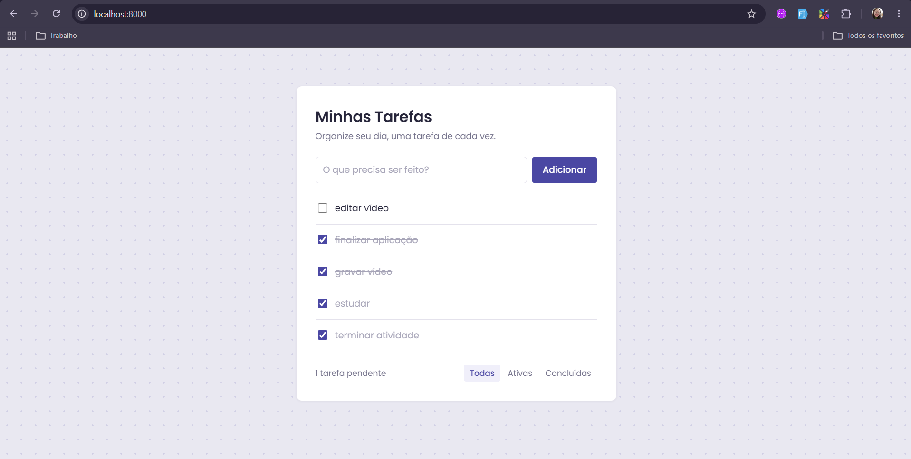

# Todo List — Clojure/ClojureScript

**Alunas:** Ana Iara Loayza e Milena Neves

**Vídeo de apresentação: https://youtu.be/LUezJV80_x8

**Tutorial original:** [Tutorial Clojure/ClojureScript: Construindo uma Aplicação
Persistente e Reativa](https://lambdageo-edu.github.io/lambdageo-tutorials/clojure/)

## Descrição

Aplicação full-stack de lista de tarefas (Todo List), construída de forma
incremental para estudar a arquitetura de aplicações funcionais modernas:

- **Backend:** Clojure, com [Ring](https://github.com/ring-clojure/ring)
  (servidor Jetty) e [Reitit](https://github.com/metosin/reitit) (roteamento),
  expondo uma API REST com CRUD completo.
- **Banco de dados:** SQLite, acessado via
  [next.jdbc](https://github.com/seancorfield/next-jdbc), com persistência
  real em disco (`prod.db`).
- **Frontend:** ClojureScript com
  [Reagent](https://github.com/reagent-project/reagent) (React) e
  [Shadow-CLJS](https://github.com/thheller/shadow-cljs), consumindo a API
  via `fetch`.

## Captura de Tela



> **Observação:** durante a gravação do vídeo de apresentação, as cores da
> tela ficaram muito vibrantes e claras, dando a impressão de que o fundo da
> página é totalmente branco. Na verdade, a interface tem um fundo lilás
> claro com um padrão pontilhado, e o cartão central é branco, como mostra a
> imagem acima, que representa o visual real da aplicação.

## Pré-requisitos

| Ferramenta                                                        | Versão mínima |
| ----------------------------------------------------------------- | ------------- |
| Java (JDK)                                                        | 11+           |
| [Clojure CLI](https://clojure.org/guides/install_clojure) (`clj`) | 1.11+         |
| Node.js (`node` / `npm`)                                          | 18+           |

## Como Rodar

1. **Clone o repositório e instale as dependências do frontend:**

   ```bash
   git clone https://github.com/milenafbn/todo-app-clojure.git
   cd todo-app-clojure
   npm install
   ```

2. **Terminal 1 — Backend (API na porta 3000):**

   ```bash
   clj -M:run
   ```

   Na primeira execução, as dependências Clojure serão baixadas e o banco
   `prod.db` será criado automaticamente.

3. **Terminal 2 — Frontend (porta 8000):**

   ```bash
   npx shadow-cljs watch app
   ```

   Aguarde a mensagem `Build completed`.

4. **Abra o navegador em:** [http://localhost:8000](http://localhost:8000)

## Endpoints da API

| Método   | Rota                    | Descrição                            |
| -------- | ----------------------- | ------------------------------------ |
| `GET`    | `/api/todos`            | Lista todas as tarefas               |
| `POST`   | `/api/todos`            | Cria uma tarefa (`{"title": "..."}`) |
| `POST`   | `/api/todos/:id/toggle` | Alterna o status feito/não feito     |
| `DELETE` | `/api/todos/:id`        | Remove uma tarefa                    |
